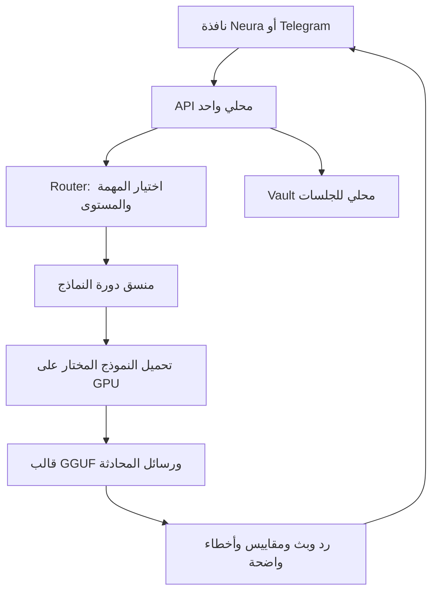

<div align="center">
  
  <h1>Neura AI — نيورا</h1>
  <p>تطبيق سطح مكتب عربي للذكاء الاصطناعي المحلي على Linux وCachyOS وArch.</p>
  <p><a href="https://github.com/MOOODEGRX-nah/Halawa-neura/releases/latest">تنزيل التطبيق</a> · <a href="docs/INSTALL_AR.md">التثبيت</a> · <a href="docs/ARCHITECTURE_AR.md">كيف تعمل النماذج</a> · <a href="docs/AUR_PUBLISH_AR.md">نشر حزمة AUR</a></p>
</div>

## افتحه كتطبيق عادي

بعد التثبيت ابحث عن **Neura AI** في قائمة التطبيقات وانقر الأيقونة. تفتح نافذة مستقلة، ويبدأ المحرك المحلي تلقائيًا. لا تحتاج تشغيل خادم أو فتح طرفية أو كتابة Python عند كل استخدام. إغلاق التطبيق يوقف الخادم الذي أنشأه فقط، وفتح الأيقونة مرة أخرى يعيد إظهار النافذة الموجودة.

في التشغيل الأول تُكتشف أوزانك الموجودة إن أمكن، أو تختار مجلدها من **الإعدادات والنماذج**. الأوزان منفصلة عن حزمة التطبيق، ولا تُحمّل ملفات كبيرة دون اختيارك. **التحديثات** من داخل التطبيق تتحقق من إصدار GitHub، وتنزّل الحزمة وتفحص SHA256، ثم يطلب النظام كلمة المرور لتثبيت التحديث. تبقى النماذج والمحادثات والإعدادات في مجلدات المستخدم.

## التثبيت على CachyOS وArch

### من GitHub Releases الآن

ثبّت مرة واحدة بالأمر التالي؛ بعد ذلك افتح التطبيق من قائمة التطبيقات:

```bash
curl -fsSL https://raw.githubusercontent.com/MOOODEGRX-nah/Halawa-neura/main/packaging/linux/install.sh | bash
```

المثبت ينزّل حزمة `neura-ai-bin` من [الإصدارات الرسمية لهذا المستودع](https://github.com/MOOODEGRX-nah/Halawa-neura/releases/latest)، ويتحقق من بصمتها، ثم يعرض معاملة التثبيت عبر pacman. ويمكن تنزيل ملف `.pkg.tar.zst` مباشرة من صفحة الإصدارات وتثبيته بمدير الحزم.

### الأمر القصير عبر AUR

```bash
paru -S neura-ai-bin
```

**حالة AUR: ملفات الحزمة جاهزة، لكنها لم تُنشر بعد في AUR.** الأمر أعلاه يصبح صالحًا بعد نشرها من حساب AUR. رفع الشيفرة إلى GitHub وحده لا يسجّل حزمة AUR. ملف `neura-ai-bin-<version>-aur.tar.gz` في كل إصدار يحتوي `PKGBUILD` و`.SRCINFO` بالبصمة الصحيحة، و[هذه خطوات النشر لأول مرة](docs/AUR_PUBLISH_AR.md).

اسم الحزمة هو `neura-ai-bin`؛ التطبيق مستقل عن `halawacore-bin` ولا يستبدله.

## المميزات والحالة الفعلية

| الميزة | ما يقدمه التطبيق |
|---|---|
| تطبيق سطح مكتب | نافذة Qt WebEngine مستقلة، أيقونة قائمة التطبيقات، تشغيل وإغلاق تلقائيان |
| محادثة عربية وإنجليزية | سجل system/user/assistant كامل وقالب GGUF الأصلي |
| اختيار النموذج | توجيه تلقائي أو تثبيت مستوى محدد، مع إظهار النموذج الفعلي |
| بث الرد | محتوى من مولّد النموذج مباشرة مع إلغاء ومهلة واضحة |
| الصور | صور PNG/JPEG/WebP مضمّنة مع Qwen3VL وملف projector المحلي |
| الجلسات | حفظ محلي حقيقي واسترجاع وحذف؛ لا تحتاج إعادة إرسال الحوار يدويًا |
| إنشاء ملفات | Task Invoice صريح، خطة اختيارية، توليد ملفات وفحوص صياغة ومتطلبات ساكنة |
| المراقبة | توافر الملفات، النماذج المقيمة، CPU/RAM وعدادات AMD عند توافرها؛ القيم غير المقاسة لا تُختلق |
| تحديث داخل التطبيق | GitHub Releases، تحقق من الحزمة، ومصادقة النظام لتثبيت إصدار أحدث |
| اختيار مجلد النماذج | نافذة إعدادات دون تعديل YAML يدويًا، مع بيان الملفات المفقودة أو غير المكتملة |
| البحث وTelegram | إضافات اختيارية؛ Telegram يتصل بنفس API ولا يحمّل مجموعة نماذج أخرى |
| الصوت | محوّلات محلية اختيارية؛ يحتاج whisper.cpp CLI أو Piper وصوتًا محليًا مناسبًا؛ ليس جاهزًا بمجرد وجود أوزان Whisper/Kokoro |

لا تُشغّل الشيفرة المولدة تلقائيًا بصلاحيات المستخدم، ولا يدّعي التطبيق أن نجاح AST يثبت سلوك البرنامج. تنفيذ Terminal وGit وإرسال البريد غير مفعّل. مسودة البريد لا ترسل شيئًا. لا توجد منظومة RAG أو وكلاء عامة في هذا الإصدار.

## أي نموذج ينفذ أي مهمة؟

| المستوى | النموذج الحالي | الاستخدام |
|---|---|---|
| FAST | Gemma 3 4B IT، داخل الملف المحلي المسمى `gemma-4-E4B-Q4_K_M.gguf` | أسئلة سريعة ومحادثات قصيرة |
| DAILY | Qwen3.5 9B Q4_K_M | المحادثة اليومية والتلخيص والترجمة |
| EXPERT | Qwen3.5 9B مجتمعي مقطّر | التحليل والتخطيط؛ ليس نموذج Claude من Anthropic |
| CODER | النموذج المقطّر نفسه مؤقتًا | البرمجة وتصحيح الشيفرة وإنشاء الملفات |
| VISION | Qwen3VL 8B + mmproj | فهم الصور المرفقة |

يمكن اختيار Qwen2.5 Coder من الإعدادات بعد اكتمال ملفه الصحيح. علامة `.aria2` تعني أن التنزيل يحتاج مراجعة، وتمنع التفعيل؛ لا تحذفها لمجرد تجاوز الفحص. Qwen3.8 غير مفعّل لعدم وجود ملف محلي مثبت له. لا تُوزع أوزان النماذج مع التطبيق، وتراخيصها ومصادرها مستقلة عن ترخيص الشيفرة.

## كيف تتواصل النماذج؟

النماذج لا تتصل ببعضها مباشرة. منسق واحد يمرر الرسائل والنتائج المنظمة، ويحمّل نموذج محادثة أو صورة واحدًا في كل مرة. EXPERT وCODER يشتركان في الملف المقيم نفسه عندما تكون أوزانهما متطابقة.



المحادثة العادية تستدعي نموذجًا واحدًا، ولا تمر بكل النماذج. زر **إنشاء ملفات من الطلب** يبدأ مسار Invoice منفصلًا:

1. يُنشأ Invoice منظم يتضمن الطلب والمتطلبات والقيود والنموذج المستهدف.
2. عند طلب خطة، يستقبل EXPERT الفاتورة ويعيد خطة.
3. يستقبل CODER الفاتورة والخطة وينشئ الملفات.
4. يتحقق التطبيق من المسارات والتكرارات وصياغة Python/JSON والملفات والرموز المطلوبة.
5. عند فشل الفحص، يُعاد سبب الفشل إلى CODER لمحاولة تصحيح واحدة.
6. تُحفظ النتائج الخام والـ metadata والملفات المقبولة. النتيجة تصف الفحص بأنه ساكن، ولا تقول إن البرنامج شُغّل أو اجتاز اختبارًا سلوكيًا.

[تفاصيل المعمارية والتوجيه وإدارة الذاكرة](docs/ARCHITECTURE_AR.md).

## إعداد النماذج والموارد

النموذج لا يدخل الحزمة لأن أحجام الأوزان كبيرة ولها تراخيص مستقلة. اختر مجلد الملفات من الإعدادات. سجلات التطبيق تستخدم أسماء الملفات المحددة في `configs/models.yaml` وتتحقق من توافرها وحجمها. ملف Vision يحتاج `mmproj-Qwen3VL-8B-Instruct-F16.gguf` إلى جانبه.

النظام المستهدف لهذا الإصدار: Linux x86_64 مع AVX2 وPython 3.14، مع Qt6 وVulkan. تحتوي الحزمة على اعتماديات Backend ومحرك llama-cpp-python؛ يثبت مدير الحزم Qt وNumPy واعتماديات النظام. يلزم تعريف Vulkan المناسب للبطاقة، مثل `vulkan-radeon` لبطاقات AMD. يمكنك اختيار CPU من الإعدادات صراحةً عند الحاجة. الاختبارات المحلية أُجريت على RX 9060 XT؛ ليست ضمانًا لنفس الأداء على كل عتاد.

تقدير VRAM ليس قياس تخصيص مضمونًا. زيادة السياق تزيد الذاكرة. عند فشل التحميل يظهر السبب بدل استبدال الملف بصمت. عند غياب عدادات العتاد تعرض الواجهة قيمة مجهولة.

## التحديث والبيانات

من داخل التطبيق اختر **التحديثات** ثم **تنزيل التحديث وتثبيته**. تنفذ العملية عبر حزمة pacman، وليس بكتابة ملفات عشوائية فوق تثبيت النظام. يعيد مساعد Polkit التحقق من الإصدار وبصمة GitHub، وينسخ الحزمة إلى مساحة مملوكة للجذر قبل تثبيتها. النسخة المثبتة فقط تدعم تثبيت التحديث؛ تشغيل الشيفرة من checkout لا يمنح صلاحيات تثبيت تلقائية.

| البيانات | الموضع الافتراضي |
|---|---|
| الإعدادات | `~/.config/neura-ai/settings.json` |
| الجلسات والمشاريع ورمز API | `~/.local/share/neura-ai/` |
| سجل التشخيص | `~/.local/state/neura-ai/backend.log` |
| حزم التحديث المؤقتة | `~/.cache/neura-ai/updates/` |
| ملفات التطبيق المثبتة | `/opt/neura-ai/` |

التحديث لا يحذف مجلد أوزانك أو بياناتك. حفظ المحادثة لا يعني إنشاء ذاكرة دلالية أو تدريب النموذج. الاستدلال محلي؛ فحص التحديثات والبحث الاختياري يتصلان بالإنترنت، ورسائل Telegram تمر بخدمة Telegram عند تفعيله.

## البناء والاختبارات للمطورين

واجهة المستخدم لا تحتاج Node أثناء التشغيل؛ CSS مبني مسبقًا. بناء CSS اختياري عبر `npm ci && npm run build:css`.

```bash
python -m venv .venv
.venv/bin/python -m pip install -r requirements-dev.txt
NEURA_DATA_DIR=/tmp/neura-test-data .venv/bin/python -m pytest -q
```

اجتازت النسخة المحلية 94 اختبارًا، مع اختبار فتح النافذة وتوليد رد من runtime المعبأ. [تفاصيل التحقق وحدوده](docs/QA_v0.3.0_AR.md). الاختبارات الافتراضية لا تحتاج أوزانًا أو GPU أو اتصال Telegram. [GitHub Actions](https://github.com/MOOODEGRX-nah/Halawa-neura/actions) يختبر الشيفرة ويبني حزمة Arch ومحرك Vulkan وينشر إصدارًا عند رفع نسخة جديدة في `VERSION`. يتضمن الإصدار حزمة pacman، وأرشيف runtime، وبصمات SHA256، وحزمة إعداد AUR. [التفاصيل](docs/INSTALL_AR.md).

## الترخيص

شيفرة Neura تحت [MIT](LICENSE). المكتبات المضمّنة تحت تراخيصها المرفقة، ومنها MIT وBSD وApache وMPL وPSF. أوزان النماذج ليست ضمن الحزمة ويجب التحقق من شروط ناشريها قبل إعادة توزيعها.
