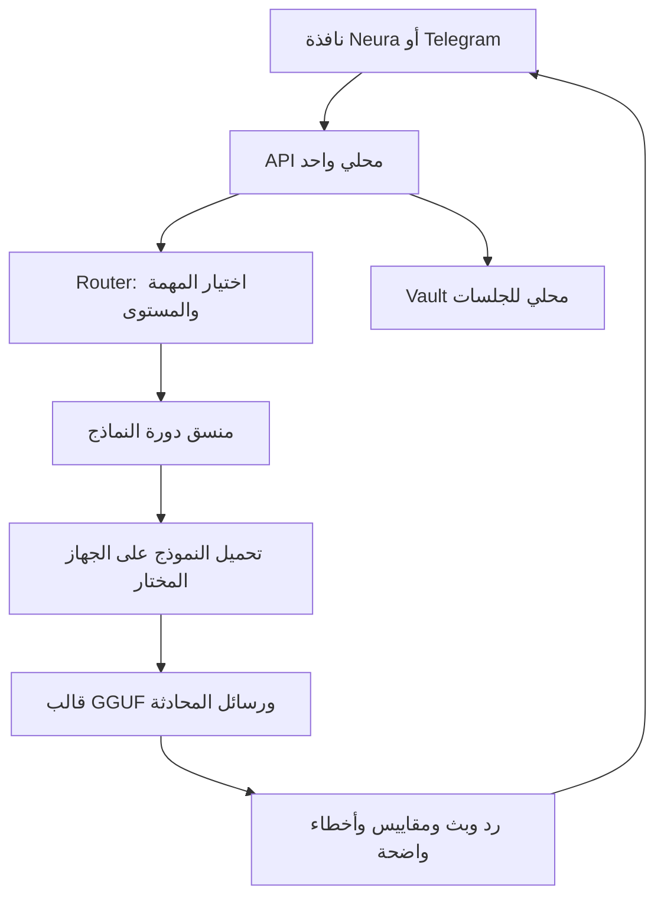

<div align="center">
  
  <h1>Neura AI — نيورا</h1>
  <p>تطبيق سطح مكتب عربي للذكاء الاصطناعي المحلي على Linux وCachyOS وArch.</p>
  <p><a href="https://github.com/MOOODEGRX-nah/Halawa-neura/releases/latest">تنزيل التطبيق</a> · <a href="docs/INSTALL_AR.md">التثبيت</a> · <a href="docs/ARCHITECTURE_AR.md">كيف تعمل النماذج</a> · <a href="docs/AUR_PUBLISH_AR.md">نشر حزمة AUR</a></p>
</div>

**الإصدار 0.5.0 — مساعد شخصي:** ذاكرة لما تطلب حفظه، وتذكيرات ومؤقتات بالعربية مع إشعارات سطح المكتب، والوقت والتاريخ الهجري، وحاسبة آمنة، وطقس من Open-Meteo، وتلخيص صفحات الويب وويكيبيديا مع المصادر، ومحادثة صوتية يرد فيها Neura بصوته، وصفحة «المساعد» لإدارة كل ذلك. التفاصيل في [دليل المساعد](docs/ASSISTANT_AR.md) و[ملاحظات الإصدار](docs/RELEASE_v0.5.0_AR.md). يبقى ما سبق: حماية الموارد أثناء اللعب على RX 580، ووصفتا CV ودليل الخدمات، والتعديل المحدود. الأوزان منفصلة عن الحزمة. لا يُدعى نجاح KDE أو FPS أثناء لعب فعلي دون تجربتها.

جرّب: «ذكرني بعد 20 دقيقة أن أشرب الماء»، «تذكر أن اسمي محمد»، «ما الطقس في جدة؟»، «كم الساعة في لندن؟»، «احسب 15% من 2400»، «لخص هذه الصفحة https://…»، أو اكتب `/help`.

يمكنك كتابة «هل يمكنك ان تفتح لي موقع youtube» أو «ابحث في يوتيوب عن تعلم Python» أو «افتح Brave» مباشرةً في المحادثة. يرسل التطبيق الطلب عبر المهارة المتاحة دون تحميل نموذج، ويطلب اختيار الهدف الملتبس داخل المحادثة. نجاح الفتح يعني قبول طلب التشغيل فقط. عبارات الشرح والنفي والاقتباسات لا تُنفذ كأوامر. فتح ملف أو مجلد يتطلب مكانًا مختارًا في الإعدادات أو مشروعًا محفوظًا.

يدعم «افتح ديسكورد» و«افتح تطبيق Discord» إذا كان التطبيق في السجل الموثوق. سؤال «هل تعرف الديسكورد بالإنجليزي» لا يفتحه، ويمكن أن يتبعه «هذا هوا افتحه» في المحادثة نفسها خلال خمس دقائق. الهدف المجهول لا يعرض تطبيقات غير مرتبطة، ولا تعني معرفة الاسم أن التطبيق مثبت.

زر المجلد الصغير قرب حقل المحادثة يفتح مشاريعك المحفوظة. اكتب «عدل هذا المشروع…» أو «عدل مشروع السيرة الذاتية…» لفتح المساحة وتجهيز طلب التعديل؛ اختر الملف المناسب وراجع الطلب قبل توليده. ضوابط الإتاحة وإلغاء الصلاحيات في «الإعدادات والنماذج ← الأذونات والمهارات». العودة للمحادثة لا تمحو مسودة المحرر ولا توقف توليد المشروع.

اكتب «برمج لي موقع للcv» أو «برمج لي لعبة XO» أو «اكتب لي كود Python لحساب المصروفات» لإنشاء مشروع وفتح المساحة دون إعادة الطلب في نموذج آخر. مع مشروع مفتوح ومحفوظ، «أضف زر تسجيل دخول» ينشئ مهمة تعديل للمشروع نفسه بملفاته الفعلية. راجع النتيجة: Login عنصر تجريبي، وليس نظام مصادقة. يرفض مسار التعديل فقدان المحتوى/التحكم والميزات المطلوبة وفق نطاق فحوص المصدر والمعاينة؛ لا يثبت ذلك التكافؤ السلوكي الكامل. التعديلات غير المحفوظة أو المهمة النشطة تحتاج مراجعة قبل توليد آخر. أسئلة الشرح مثل «اشرح هذا الكود» تبقى في المحادثة.

## افتحه كتطبيق عادي

بعد التثبيت ابحث عن **Neura AI** في قائمة التطبيقات وانقر الأيقونة. تفتح نافذة مستقلة، ويبدأ المحرك المحلي تلقائيًا. لا تحتاج تشغيل خادم أو فتح طرفية أو كتابة Python عند كل استخدام. إغلاق التطبيق يوقف الخادم الذي أنشأه فقط، وفتح الأيقونة مرة أخرى يعيد إظهار النافذة الموجودة.

في التشغيل الأول تُكتشف أوزانك الموجودة إن أمكن، أو تختار مجلدها من **الإعدادات والنماذج**. الأوزان منفصلة عن حزمة التطبيق، ولا تُحمّل ملفات كبيرة دون اختيارك. **التحديثات** تتضمن تنزيلًا من GitHub وفحص SHA256 ومصادقة النظام. منذ 0.4.11 يؤجل التحديث الإيقاف عند تعديل غير محفوظ أو عمل نشط، ويعيد التحقق قبل الإيقاف ويستعيد الخدمة بعد إلغاء المصادقة. ثبت هذا في Qt offscreen؛ معاملة التحديث الإدارية الحقيقية لم تُختبر، ولذلك `N026` جزئي. تبقى النماذج والمحادثات والإعدادات خارج ملفات التطبيق المثبتة.

## التثبيت على CachyOS وArch

### من GitHub Releases الآن

ثبّت مرة واحدة بالأمر التالي؛ بعد ذلك افتح التطبيق من قائمة التطبيقات:

```bash
curl -fsSL https://raw.githubusercontent.com/MOOODEGRX-nah/Halawa-neura/main/packaging/linux/install.sh | bash
```

المثبت يقرأ تأكيد pacman من الطرفية مباشرةً حتى عند تشغيله عبر `curl | bash`، ويحتفظ بالحزمة الموثقة لإعادة المحاولة في `~/.cache/neura-ai/updates/`. ينزّل حزمة `neura-ai-bin` من [الإصدارات الرسمية لهذا المستودع](https://github.com/MOOODEGRX-nah/Halawa-neura/releases/latest)، ويتحقق من بصمتها، ثم يعرض معاملة التثبيت عبر pacman. ويمكن تنزيل ملف `.pkg.tar.zst` مباشرة من صفحة الإصدارات وتثبيته بمدير الحزم.

الأمر أعلاه يحمّل آخر إصدار **منشور**، وقد يختلف عن المرشح المحلي الموصوف هنا؛ لا ينشر بناء الحزمة إصدارًا تلقائيًا.

### الأمر القصير عبر AUR

```bash
paru -S neura-ai-bin
```

**حالة AUR: ملفات الحزمة جاهزة، لكنها لم تُنشر بعد في AUR.** الأمر أعلاه يصبح صالحًا بعد نشرها من حساب AUR. رفع الشيفرة إلى GitHub وحده لا يسجّل حزمة AUR. ملف `neura-ai-bin-<version>-aur.tar.gz` في كل إصدار يحتوي `PKGBUILD` و`.SRCINFO` بالبصمة الصحيحة، و[هذه خطوات النشر لأول مرة](docs/AUR_PUBLISH_AR.md).

اسم الحزمة هو `neura-ai-bin`؛ التطبيق مستقل عن `halawacore-bin` ولا يستبدله.

## المميزات والحالة الفعلية

| الميزة | ما يقدمه التطبيق |
|---|---|
| تطبيق سطح مكتب | نافذة Qt WebEngine مستقلة، أيقونة قائمة التطبيقات، تشغيل وإغلاق تلقائيان |
| محادثة عربية وإنجليزية | سجل system/user/assistant كامل وقالب GGUF الأصلي |
| اختيار النموذج | توجيه تلقائي أو تثبيت مستوى محدد، مع إظهار النموذج الفعلي |
| بث الرد | محتوى من مولّد النموذج مباشرة مع إلغاء ومهلة واضحة |
| الصور | مسار صور PNG/JPEG/WebP وMTMD مع Qwen3VL وprojector؛ نجاح صورة فعلية عبر الحزمة ما زال يحتاج قبول `N093` |
| الجلسات | حفظ محلي حقيقي واسترجاع وحذف؛ لا تحتاج إعادة إرسال الحوار يدويًا |
| إنشاء ملفات | Task Invoice صريح، خطة اختيارية، توليد ملفات وفحوص صياغة ومتطلبات ساكنة |
| مساحة المبرمج | كود فعلي أثناء التوليد يسارًا، معاينة يمينًا، تبديل وحفظ وتعارضات ومشاريع دائمة |
| معاينة موقع ثابت | HTML/CSS/JavaScript في إطار معزول، ومعاينة كاملة بالحدود نفسها |
| فهرس المشروع | حقائق وملخص من الملفات، وفحص hash للحداثة؛ أسئلة التعريف واللغة دون نموذج، وليست ذاكرة شخصية أو RAG |
| مهارات سطح المكتب | فتح موقع وبحث Brave/YouTube وملف ومجلد وتطبيق، وصلاحيات محددة قابلة للإلغاء |
| المراقبة | توافر الملفات، النماذج المقيمة، CPU/RAM وعدادات AMD عند توافرها؛ القيم غير المقاسة لا تُختلق |
| تحديث داخل التطبيق | تنزيل وتحقق وPolkit، وتأجيل عند العمل النشط/غير المحفوظ في 0.4.11؛ اختبار التثبيت الإداري الحي ما زال مفتوحًا في `N026` |
| اختيار مجلد النماذج | نافذة إعدادات دون تعديل YAML يدويًا، مع بيان الملفات المفقودة أو غير المكتملة |
| البحث وTelegram | بحث مقتطفات اختياري؛ Telegram عميل API، لكن اكتشاف منفذ Qt المتغير لم يكتمل بعد (`N103`) |
| الصوت | محوّلات محلية اختيارية؛ يحتاج whisper.cpp CLI أو Piper وصوتًا محليًا مناسبًا؛ ليس جاهزًا بمجرد وجود أوزان Whisper/Kokoro |

لا تُشغّل الشيفرة المولدة تلقائيًا بصلاحيات المستخدم، ولا يدّعي التطبيق أن نجاح AST يثبت سلوك البرنامج. تنفيذ Terminal وGit وإرسال البريد غير مفعّل. مسودة البريد لا ترسل شيئًا. لا توجد منظومة RAG أو وكلاء عامة في هذا الإصدار.

## أي نموذج ينفذ أي مهمة؟

| المستوى | النموذج الحالي | الاستخدام |
|---|---|---|
| FAST | Gemma 3 4B IT، داخل الملف المحلي المسمى `gemma-4-E4B-Q4_K_M.gguf` | أسئلة سريعة ومحادثات قصيرة |
| DAILY | Qwen3.5 9B Q4_K_M | المحادثة اليومية والتلخيص والترجمة |
| EXPERT | Qwen3.5 9B مجتمعي مقطّر | التحليل والتخطيط؛ ليس نموذج Claude من Anthropic |
| CODER | Qwen2.5 Coder 14B عند تفعيله؛ وإلا النموذج المقطّر | البرمجة وتصحيح الشيفرة وإنشاء الملفات |
| VISION | Qwen3VL 8B + mmproj | فهم الصور المرفقة |

يمكن اختيار Qwen2.5 Coder من الإعدادات بعد اكتمال ملفه الصحيح. علامة `.aria2` تعني أن التنزيل يحتاج مراجعة، وتمنع التفعيل؛ لا تحذفها لمجرد تجاوز الفحص. Qwen3.8 غير مفعّل لعدم وجود ملف محلي مثبت له. لا تُوزع أوزان النماذج مع التطبيق، وتراخيصها ومصادرها مستقلة عن ترخيص الشيفرة.

## كيف تتواصل النماذج؟

النماذج لا تتصل ببعضها مباشرة. منسق واحد يمرر الرسائل والنتائج المنظمة، ويحمّل نموذج محادثة أو صورة واحدًا في كل مرة. EXPERT وCODER يشتركان في الملف المقيم نفسه عندما تكون أوزانهما متطابقة.



المحادثة العادية تستدعي نموذجًا واحدًا، ولا تمر بكل النماذج. طلب إنشاء صريح مثل «أنشئ موقع سيرة» يفتح مشروعًا فورًا. زر المجلد يعيد فتح المشاريع المحفوظة. المسار الجديد يعيد استعمال Invoice والمنسق نفسه:

1. يُنشأ Invoice منظم يتضمن الطلب والمتطلبات والقيود والنموذج المستهدف.
2. عند طلب خطة، يستقبل EXPERT الفاتورة ويعيد JSON مختصرًا بخطوات وأسماء ملفات. لا يدخل coder قبل نهاية `stop` وعقد صالح؛ الخطة المبتورة تفشل بوضوح ولا تمحو آخر مراجعة صالحة.
3. يستقبل CODER الفاتورة والخطة الاختيارية، ويبث محتوى الملفات الحقيقي إلى المحرر.
4. يتحقق التطبيق من المسارات والتكرارات وصياغة Python/JSON وJavaScript/CSS والروابط المحلية والمتطلبات.
5. تُحفظ الملفات المقبولة في مراجعة ذرية مع الفهرس والملخص. المخرج الفاشل أو الملغى يبقى مسودة ولا يمحو آخر مراجعة صالحة؛ لا توجد دورة تصحيح إضافية مفروضة في مساحة العمل.
6. تتاح معاينة HTML الثابت بعد الفحص. هذا فحص ساكن؛ لا ينفذ Python أو بناء مشروع أو تثبيت مكتبات. API القديم المتزامن محفوظ للتوافق وله محاولة التصحيح القديمة.

الملخص بيانات موجزة، وليس تدريبًا للنموذج. أسئلة التعريف واللغة والغرض تُجاب من الفهرس مباشرة. التعديل يرسل الملف الفعلي المحدد؛ تُرفض الكتابة فوق ملف موجود لم يُرسل مصدره. تفاصيل القياس والحدود في [الدليل](docs/WORKSPACE_V2_GUIDE_AR.md).

[تفاصيل المعمارية والتوجيه وإدارة الذاكرة](docs/ARCHITECTURE_AR.md).

## إعداد النماذج والموارد

النموذج لا يدخل الحزمة لأن أحجام الأوزان كبيرة ولها تراخيص مستقلة. اختر مجلد الملفات من الإعدادات. سجلات التطبيق تستخدم أسماء الملفات المحددة في `configs/models.yaml` وتتحقق من توافرها وحجمها. ملف Vision يحتاج `mmproj-Qwen3VL-8B-Instruct-F16.gguf` إلى جانبه.

النظام المستهدف لهذا الإصدار: Linux x86_64 مع AVX2 وPython 3.14، مع Qt6 وVulkan. تحتوي الحزمة على اعتماديات Backend ومحرك llama-cpp-python؛ يثبت مدير الحزم Qt وNumPy واعتماديات النظام. يلزم تعريف Vulkan المناسب للبطاقة، مثل `vulkan-radeon` لبطاقات AMD. يمكنك اختيار CPU من الإعدادات صراحةً عند الحاجة. الاختبارات المحلية أُجريت على RX 9060 XT؛ ليست ضمانًا لنفس الأداء على كل عتاد.

تقدير VRAM ليس قياس تخصيص مضمونًا. زيادة السياق تزيد الذاكرة. عند فشل التحميل يظهر السبب بدل استبدال الملف بصمت. عند غياب عدادات العتاد تعرض الواجهة قيمة مجهولة.

## التحديث والبيانات

من داخل التطبيق اختر **التحديثات** ثم **تنزيل التحديث وتثبيته**. تنفذ العملية عبر حزمة pacman، وليس بكتابة ملفات عشوائية فوق تثبيت النظام. يعيد مساعد Polkit التحقق من الإصدار وبصمة GitHub، وينسخ الحزمة إلى مساحة مملوكة للجذر قبل تثبيتها. النسخة المثبتة فقط تدعم تثبيت التحديث؛ تشغيل الشيفرة من checkout لا يمنح صلاحيات تثبيت تلقائية.

| البيانات | الموضع الافتراضي |
|---|---|
| الإعدادات | `~/.config/neura-ai/settings.json` |
| الجلسات والمشاريع ورمز API | `~/.local/share/neura-ai/` |
| المشاريع الجديدة | `~/.local/share/neura-ai/workspace/<name>-<id>/` |
| سجل التشخيص | `~/.local/state/neura-ai/backend.log` |
| حزم التحديث المؤقتة | `~/.cache/neura-ai/updates/` |
| ملفات التطبيق المثبتة | `/opt/neura-ai/` |

التحديث لا يحذف مجلد أوزانك أو بياناتك. حفظ المحادثة لا يعني إنشاء ذاكرة دلالية أو تدريب النموذج. الاستدلال محلي؛ فحص التحديثات والبحث الاختياري يتصلان بالإنترنت، ورسائل Telegram تمر بخدمة Telegram عند تفعيله.

## البناء والاختبارات للمطورين

واجهة المستخدم لا تحتاج Node أثناء التشغيل؛ CSS ومحلل Markdown مضمنان محليًا. أعد بناء أصول الواجهة عبر `npm ci --ignore-scripts && npm run build:assets` بعد تعديلها.

```bash
python -m venv .venv
.venv/bin/python -m pip install -r requirements-dev.txt
env NEURA_DATA_DIR=/tmp/neura-test-data .venv/bin/python -m pytest -q
```

اجتاز التصحيح المحلي **208 اختبارًا**. [نتائج النسخة الحالية وQt وحدودها](docs/QA_v0.4.4_AR.md) مفصولة حسب نوع الدليل؛ محاكيات الاختبار لا تثبت تنفيذ إجراء على الجهاز الحقيقي. [نتائج 0.4.0 وحدودها](docs/QA_v0.4.0_AR.md) و[نتائج 0.3.0](docs/QA_v0.3.0_AR.md) تاريخية مستقلة. الاختبارات الافتراضية لا تحتاج أوزانًا أو GPU أو اتصال Telegram. للبناء الحقيقي استخدم `tools/build_linux_release.py` مع شجرة vendor المطابقة للاعتماديات المثبتة في `constraints-tested.txt`. مسار GitHub Actions على main يختبر المصدر ثم يبني الحزم وينشر الإصدار إذا لم يكن منشورًا، مع ملاحظات الإصدار المطابقة لـVERSION. [التفاصيل](docs/INSTALL_AR.md).

## الترخيص

شيفرة Neura تحت [MIT](LICENSE). المكتبات المضمّنة تحت تراخيصها المرفقة، ومنها MIT وBSD وApache وMPL وPSF. أوزان النماذج ليست ضمن الحزمة ويجب التحقق من شروط ناشريها قبل إعادة توزيعها.
